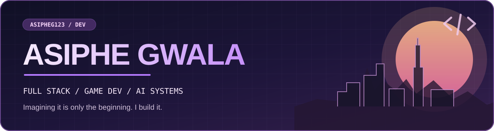

  
    
  
  

    
    
    
  

---

## 👋 About me

I'm **Asiphe**, a Johannesburg-based developer who enjoys turning ambitious ideas into things people can actually use.

My world sits at the intersection of **full-stack development, game design, automation, and AI**. I work across web interfaces, backend systems, creative tools, and experimental AI products.

- 🎮 Studying **Computer & Information Sciences — Game Design & Development**
- 💻 Building full-stack applications, dashboards, and backend systems
- 🧠 Exploring AI-powered products, agents, and voice interfaces
- 🚀 Building **AutoGrowth OS + AAVA** with our team
- 🌍 Based in **Johannesburg, South Africa**

 

## ✨ Currently building

<table>
<tr>
<td width="50%" valign="top">

### 🪐 AutoGrowth OS (AOS)

An AI-native operating environment built around the way people work: connected apps, durable workflows, shared context, and permission-aware automations.

</td>
<td width="50%" valign="top">

### 🎙️ AAVA

**AutoGrowth's Autonomous Virtual Assistant** — the conversational and voice interface for AOS. We're exploring natural interaction, tool use, and multi-model orchestration.

</td>
</tr>
</table>

> Our focus: build the founder-first experience, prove that it works, then grow it into something others can use.

## 🛠️ Languages, tools & creative stack

 

## 🧩 Selected public work

| Project | What it explores |
| :-- | :-- |
| **[AutoGrowth Site](https://github.com/AsipheG123/AutoGrowth-Site)** | Our agency's web presence and digital foundation |
| **[Clarity Case Study Library](https://github.com/AsipheG123/Clarity-Global---Case-Study-Library-Demo)** | A more visual, explorable portfolio of work |
| **[Grove Project](https://github.com/AsipheG123/Grove-Project)** | Another project from my development journey |
| **[Terry Bell Memorial](https://github.com/AsipheG123/terry-bell-memorial)** | A website created in loving memory |

## ⚡ A little more about me

Beyond code: **game design, anime & manga, creative storytelling, fitness, and building things from scratch**.

I like projects that sit somewhere between *"that would be cool"* and *"what if we actually built it?"*

  **YOUR AI. YOUR APPS. YOUR WORLD.**

  Designed with care • Built to keep evolving • <a href="https://github.com/AsipheG123">github.com/AsipheG123</a>

